# Dispensa Class Diagram (UML)

**Informatica – classe 4Bi – Edizione Completa e Integrata**

---

## Indice

1. Introduzione
2. La classe
3. La visibilità
4. Attributi e metodi: sintassi completa
5. Dal diagramma al codice Java (e viceversa)
6. Le relazioni tra classi
7. Altri elementi del class diagram
8. Esempi completi
9. Come si costruisce un class diagram
10. Principi di buona progettazione
11. Errori comuni
12. Strumenti
13. Esercizi con soluzione
14. Domande di autoverifica
15. Glossario
16. Schema di ripasso

---

## 1. Introduzione

### 1.1 Che cos'è UML

**UML** (*Unified Modeling Language*) è un linguaggio **grafico standard** per descrivere, progettare e documentare il software, in particolare quello a oggetti. Non è un linguaggio di programmazione: non si esegue, si **disegna**. È uno standard internazionale, quindi un diagramma UML può essere letto da qualsiasi sviluppatore nel mondo.

UML comprende molti tipi di diagrammi, divisi in due famiglie:

| Famiglia | Descrive | Esempi |
|---|---|---|
| **Diagrammi strutturali** | *Com'è fatto* il sistema | class diagram, object diagram, package diagram, component diagram |
| **Diagrammi comportamentali** | *Cosa fa* il sistema nel tempo | use case diagram, sequence diagram, activity diagram, state diagram |

### 1.2 Che cos'è il class diagram

Il **class diagram** (diagramma delle classi) è il diagramma UML più usato. Rappresenta la **struttura statica** di un programma a oggetti, cioè:

- quali **classi** esistono;
- quali **attributi** (i dati) e quali **metodi** (le operazioni) ha ciascuna classe;
- quali **relazioni** collegano le classi tra loro (chi conosce chi, chi eredita da chi, chi è parte di chi).

"Statica" significa che il diagramma è come una **fotografia dell'architettura**: non mostra l'ordine in cui vengono chiamati i metodi mentre il programma gira (per quello si usa il *sequence diagram*).

### 1.3 A cosa serve

- **Progettare** prima di programmare: ragionare su quali classi servono e su come collaborano evita di dover riscrivere il codice a metà strada.
- **Comunicare** in un gruppo di lavoro: un diagramma si capisce in pochi secondi, mille righe di codice no.
- **Documentare** un programma già scritto, per chi dovrà modificarlo in futuro.
- **Essere indipendente dal linguaggio**: lo stesso diagramma può diventare codice Java, C++, C# o Python.

### 1.4 Classe e oggetto: un richiamo

Prima di disegnare le classi bisogna avere chiaro cosa sono.

- Una **classe** è un *modello*, uno stampo: descrive quali dati e quali operazioni avranno gli oggetti di quel tipo. Esempio: la classe `Studente`.
- Un **oggetto** (o *istanza*) è un esemplare concreto creato a partire dalla classe, con i suoi valori. Esempio: lo studente "Marco Rossi, matricola 1234".

Il **class diagram disegna le classi, non gli oggetti**. Un diagramma che mostra gli oggetti concreti in un certo istante si chiama *object diagram*.

Gli oggetti di una stessa classe hanno gli **stessi attributi e lo stesso comportamento**, ma **differiscono** per i **valori** degli attributi e per le **relazioni** che li legano ad altri oggetti: due studenti sono entrambi istanze di `Studente`, ma hanno nome e matricola diversi e magari professori diversi.

### 1.5 Il class diagram come schema concettuale

Un class diagram rappresenta uno **schema**: una descrizione valida per **tutte** le istanze. Se due classi sono collegate da una relazione, quella regola vale per ogni coppia di oggetti delle due classi, nei limiti della **molteplicità** indicata (per esempio "ogni `Ordine` è collegato a un `Cliente`").

### 1.6 Le tre prospettive

Lo stesso diagramma può essere disegnato con livelli di precisione diversi, a seconda dello **scopo**:

| Prospettiva | Che cosa studia | Che cosa tralascia |
|---|---|---|
| **Concettuale** | i **concetti del dominio** (ordini, clienti, prodotti...) | come verranno implementati; spesso anche navigabilità e visibilità |
| **Di specifica** | il software a livello di **interfaccia**: le *responsabilità* delle classi | i dettagli concreti dell'implementazione |
| **Implementativa** | le classi **realmente scritte** in un linguaggio OO e le strutture dati usate | niente: è vicina al codice |

Questa dispensa usa soprattutto la prospettiva **implementativa** (perché si lavora in Java), ma è importante sapere che nelle prime fasi di un progetto si disegna un diagramma **concettuale**, più semplice. Per esempio, a livello concettuale la **navigabilità** delle associazioni non ha molto senso e spesso non si indica.

### 1.7 Somiglianze con il modello Entità/Relazioni

Chi ha già visto i database riconoscerà un'aria di famiglia: il class diagram è una **estensione** del diagramma Entità/Relazioni (E/R).

| Diagramma E/R | Class diagram |
|---|---|
| Entità | Classe |
| Relazione | Associazione |
| Attributo | Attributo |
| (non previste) | **Operazioni** (i metodi) |
| (generalizzazione) | Generalizzazione, con **ereditarietà** del comportamento |
| (non prevista) | Aggregazione, composizione, interfacce |

In più, un class diagram permette di descrivere non solo i dati ma anche il **comportamento** degli oggetti.

---

## 2. La classe

Una classe si rappresenta con un **rettangolo diviso in tre compartimenti**:

| Compartimento | Contenuto |
|---|---|
| **Alto** | il **nome** della classe (iniziale maiuscola, al singolare, in genere un sostantivo) |
| **Centrale** | gli **attributi** |
| **Basso** | i **metodi** (le operazioni) |

Esempio: la classe `Studente`.

```
+--------------------------------+
|            Studente            |
+--------------------------------+
| - nome: String                 |
| - matricola: int               |
| - media: double                |
+--------------------------------+
| + Studente(nome: String,       |
|            matricola: int)     |
| + getNome(): String            |
| + setMedia(media: double): void|
| + isPromosso(): boolean        |
+--------------------------------+
```

### Livelli di dettaglio

Non è obbligatorio mostrare sempre tutto. Il livello di dettaglio dipende da **a chi è destinato il diagramma**:

- **Solo il nome:** utile per una panoramica generale con molte classi.
- **Nome e attributi:** per descrivere i dati del sistema.
- **Nome, attributi e metodi:** per la progettazione dettagliata, vicina al codice.

I compartimenti che non servono si possono omettere.

### Notazione generale completa

Nel caso più generale una classe si scrive così:

```
NomeClasse
-------------------------------------------------
nomeAttributo1 : tipo1 = valoreDiDefault1
nomeAttributo2 : tipo2 = valoreDiDefault2
-------------------------------------------------
nomeOperazione1(listaArgomenti) : tipoRestituito
nomeOperazione2(listaArgomenti) : tipoRestituito
```

Esempio: la classe `NumeroCellulare`, con prefisso e numero e i metodi per leggerli e impostarli:

```
+------------------------------+
|        NumeroCellulare       |
+------------------------------+
| prefisso : int               |
| numero : int                 |
+------------------------------+
| setPrefisso(p : int)         |
| setNumero(n : int)           |
| getPrefisso() : int          |
| getNumero() : int            |
+------------------------------+
```

### Un diagramma concettuale può essere incompleto

A livello concettuale si può tralasciare di elencare **tutti** gli attributi e **tutte** le operazioni: bastano quelli significativi. Per esempio, nelle prime fasi si può disegnare la classe `Persona` con solo `nome`, `età` e le operazioni `cambiaLavoro()` e `cambiaIndirizzo()`, e `Ordine` con `numero`, `data`, `prezzo`, `prepagato` e le operazioni `spedisci()` e `chiudi()`: il diagramma si completa man mano che il progetto avanza.

---

## 3. La visibilità

Davanti a ogni attributo e a ogni metodo si scrive un simbolo che indica la **visibilità**, cioè *quali altre classi possono usarlo*. Corrisponde ai modificatori di accesso di Java.

| Simbolo UML | Significato | In Java | Chi può accedere |
|---|---|---|---|
| `+` | pubblico | `public` | tutte le classi |
| `-` | privato | `private` | solo la classe stessa |
| `#` | protetto | `protected` | la classe, le sottoclassi e il package |
| `~` | package | (nessun modificatore) | le classi dello stesso package |

### Regola d'oro: l'incapsulamento

Gli **attributi** di norma sono **privati** (`-`), mentre i **metodi** destinati all'esterno sono **pubblici** (`+`). Chi vuole leggere o modificare un attributo lo fa tramite metodi pubblici (*getter* e *setter*). Questo si chiama **incapsulamento** ed è uno dei principi fondamentali della programmazione a oggetti, perché:

- la classe **controlla** i propri dati (per esempio il setter può rifiutare un valore non valido);
- si può **modificare l'implementazione interna** senza rompere il codice delle altre classi;
- si riducono gli errori dovuti a modifiche accidentali dall'esterno.

```java
public class ContoBancario {
    private double saldo;                       // - saldo: double

    public void preleva(double importo) {       // + preleva(importo: double): void
        if (importo > 0 && importo <= saldo) {
            saldo -= importo;                   // il controllo è nella classe!
        }
    }
}
```

Se `saldo` fosse pubblico, chiunque potrebbe scrivere `conto.saldo = -5000;`.

### La visibilità è facoltativa e dipende dal linguaggio

- La visibilità si può indicare **opzionalmente** davanti al nome di attributi e operazioni, per esempio `+ prezzo : Denaro` oppure `# impostaPrezzo(prezzo : Denaro)`.
- Attenzione: linguaggi diversi usano le **stesse parole chiave** (`public`, `private`, `protected`) con significati **leggermente diversi**, oppure hanno livelli in più (in Java la visibilità *package*, in C++ le classi *friend*). Per questo la visibilità in un diagramma UML va sempre letta secondo le regole del **linguaggio specifico** usato nel progetto.
- In particolare, secondo la definizione generale di UML `protected` significa "accessibile dalle sottoclassi"; in **Java** `protected` consente l'accesso anche alle classi dello **stesso package**.

---

## 4. Attributi e metodi: sintassi completa

### 4.1 Gli attributi

**Sintassi generale:**

```
visibilità nome: Tipo [molteplicità] = valoreIniziale
```

Esempi:

| UML | Significato | Java |
|---|---|---|
| `- nome: String` | attributo privato di tipo String | `private String nome;` |
| `- eta: int` | attributo privato intero | `private int eta;` |
| `- saldo: double = 0` | con valore iniziale | `private double saldo = 0;` |
| `- voti: int [5]` | array di 5 interi | `private int[] voti = new int[5];` |
| `- telefoni: String [0..*]` | zero o più valori | `private ArrayList<String> telefoni;` |
| `+ MAX_VOTO: int = 10` | costante pubblica | `public static final int MAX_VOTO = 10;` |

### 4.2 I metodi

**Sintassi generale:**

```
visibilità nome(parametro1: Tipo, parametro2: Tipo): TipoDiRitorno
```

Esempi:

| UML | Java |
|---|---|
| `+ getNome(): String` | `public String getNome()` |
| `+ setEta(eta: int): void` | `public void setEta(int eta)` |
| `+ preleva(importo: double): boolean` | `public boolean preleva(double importo)` |
| `- calcolaMedia(): double` | `private double calcolaMedia()` |

Il **costruttore** si indica con il nome della classe e **senza tipo di ritorno**:

```
+ Studente(nome: String, matricola: int)
```

Se la classe ha più costruttori o più metodi con lo stesso nome ma parametri diversi (**overloading**), si scrivono tutti come righe separate.

### 4.3 Elementi particolari

| Elemento | Come si indica nel diagramma | In Java |
|---|---|---|
| Membro **statico** | si **sottolinea** (es. <u>contatore: int</u>) | `static` |
| Attributo **costante** | si scrive in MAIUSCOLO, a volte con `{readOnly}` | `final` |
| Attributo **derivato** (calcolabile da altri) | si fa precedere da `/` (es. `/ eta: int`) | metodo o attributo calcolato |
| Classe o metodo **astratto** | nome in *corsivo*, oppure `<<abstract>>` | `abstract` |
| **Interfaccia** | stereotipo `<<interface>>` sopra il nome | `interface` |
| **Enumerazione** | stereotipo `<<enumeration>>` | `enum` |

I **membri statici** appartengono alla classe e non al singolo oggetto: ce n'è una sola copia condivisa da tutti gli oggetti. Esempio: un contatore che conta quanti `Studente` sono stati creati.

---

## 5. Dal diagramma al codice Java (e viceversa)

Il passaggio tra diagramma e codice è quasi **meccanico**. Questa tabella riassume le corrispondenze:

| Nel diagramma UML | Nel codice Java |
|---|---|
| Classe (rettangolo) | `class NomeClasse { ... }` |
| Attributo | variabile d'istanza |
| Metodo | metodo |
| Visibilità `+` `-` `#` | `public` `private` `protected` |
| Attributo sottolineato | `static` |
| Associazione verso un'altra classe | attributo che è un **riferimento** a quella classe |
| Molteplicità `0..*` o `1..*` | una collezione (`ArrayList`, array...) |
| Generalizzazione (freccia con triangolo) | `extends` |
| Realizzazione (tratteggio con triangolo) | `implements` |
| Dipendenza (tratteggio con freccia) | parametro, variabile locale o valore di ritorno |

### Esempio: dal diagramma al codice

Il diagramma di `Studente` della sezione 2 diventa:

```java
public class Studente {
    private String nome;
    private int matricola;
    private double media;

    public Studente(String nome, int matricola) {
        this.nome = nome;
        this.matricola = matricola;
    }

    public String getNome() {
        return nome;
    }

    public void setMedia(double media) {
        this.media = media;
    }

    public boolean isPromosso() {
        return media >= 6;
    }
}
```

### Esempio: dal codice al diagramma

Per ricavare il diagramma da una classe Java si procede così: ogni **variabile d'istanza** diventa un attributo, ogni **metodo** diventa un'operazione, `public`/`private`/`protected` diventano `+`/`-`/`#`, ogni attributo il cui **tipo è un'altra classe del progetto** diventa una **relazione** (e di solito *non* si riscrive tra gli attributi, perché la linea di relazione dice già la stessa cosa).

### Esempio con un attributo statico: la classe Fattura

Una classe che conta quante fatture sono state emesse: il contatore è **statico** (appartiene alla classe, non al singolo oggetto) e quindi nel diagramma è **sottolineato**.

```
+------------------------------------------+
|                 Fattura                  |
+------------------------------------------+
| + importo : float                        |
| + data : Date                            |
| + cliente : String                       |
| - fattureEmesse : int = 0   (sottolineato)|
+------------------------------------------+
| + Fattura()                              |
+------------------------------------------+
```

```java
public class Fattura {
    public float importo;
    public Date data = new Date();
    public String cliente;
    private static int fattureEmesse = 0;     // static: una sola copia per tutta la classe

    public Fattura() {
        fattureEmesse++;                      // ogni nuova fattura incrementa il contatore
    }
}
```

Ogni volta che si crea una `Fattura` con `new`, il costruttore incrementa il contatore **condiviso** da tutte le fatture.

---

## 6. Le relazioni tra classi

Le classi raramente vivono da sole: **collaborano**. Le relazioni sono la parte più importante del class diagram. Le principali sono sei:

| N. | Relazione | Domanda a cui risponde |
|---|---|---|
| 1 | Associazione | "A conosce / usa B?" |
| 2 | Aggregazione | "A ha B, ma B esiste anche da solo?" |
| 3 | Composizione | "A è fatto di B, e B non esiste senza A?" |
| 4 | Generalizzazione | "A **è un** B?" |
| 5 | Realizzazione | "A **implementa** il contratto B?" |
| 6 | Dipendenza | "A usa B solo per un attimo?" |

### 6.1 Associazione

L'**associazione** indica che due classi sono **collegate**: gli oggetti dell'una conoscono e usano gli oggetti dell'altra. Si disegna con una **linea continua**.

Sulla linea si possono indicare:

- il **nome** dell'associazione (di solito un verbo: "insegna a", "possiede", "lavora per");
- i **ruoli** che le classi hanno nella relazione (es. "docente", "allievo");
- la **molteplicità** a ciascun estremo;
- la **navigabilità**, con una freccia aperta.

```
Docente  1 ------------- insegna a ------------- 0..*  Studente
```

Si legge: *"Un docente insegna a zero o più studenti; uno studente è seguito da esattamente un docente."* (la molteplicità di un estremo dice **quanti oggetti di quel lato** sono coinvolti per ogni oggetto dell'altro lato).

#### Associazione tra classi e legami tra oggetti

Un'associazione è una **connessione logica tra classi**; a livello di oggetti diventa un **legame** tra le istanze delle classi coinvolte. Ad esempio, l'associazione "capoluogo di" tra `Città` e `Regione` si traduce nei legami concreti "Milano è capoluogo della Lombardia", "Torino è capoluogo del Piemonte"...

#### Il nome dell'associazione e il verso di lettura

Il **nome** è facoltativo. Per evitare ambiguità si può aggiungere un piccolo triangolo (o un `>` / `<`) che indica il **verso di lettura**. Esempio: tra `Linea` e `Punto` ci sono due associazioni lette in versi opposti, "*Linea* **identificata da** *Punto*" e "*Punto* **appartiene a** *Linea*". Con le molteplicità: ogni linea è identificata da esattamente **2** punti; un punto può appartenere a **0..\*** linee.

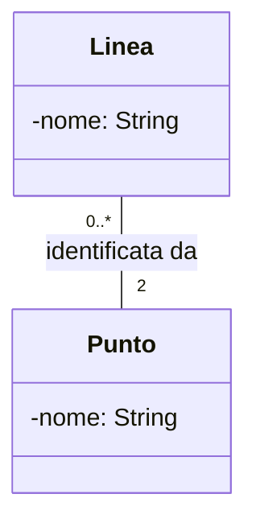

#### Navigabilità: associazione unidirezionale e bidirezionale

- **Bidirezionale** (linea semplice, senza frecce): entrambe le classi conoscono l'altra.
- **Unidirezionale** (freccia aperta): solo la classe da cui parte la freccia conosce l'altra.

**Codice Java, associazione unidirezionale** (`Docente` → `Studente`):

```java
public class Docente {
    private String nome;
    private ArrayList<Studente> studenti = new ArrayList<>();   // 0..*

    public void aggiungiStudente(Studente s) {
        studenti.add(s);
    }
}

public class Studente {
    private String nome;
    // nessun riferimento a Docente: lo studente non conosce il docente
}
```

**Codice Java, associazione bidirezionale:** entrambe le classi hanno un attributo che punta all'altra.

```java
public class Docente {
    private ArrayList<Studente> studenti = new ArrayList<>();
}

public class Studente {
    private Docente docente;            // 1
}
```

La navigabilità bidirezionale è comoda ma va usata con cautela, perché obbliga a **mantenere coerenti** i due lati (se aggiungo uno studente a un docente, devo anche dire allo studente chi è il suo docente).

#### Il significato della navigabilità

La **navigabilità** è un verso privilegiato dell'associazione e si indica con una **freccia** sulla linea. Il suo significato cambia con la prospettiva:

| Prospettiva | Che cosa significa la freccia da `Ordine` verso `Cliente` |
|---|---|
| **Specifica** | ogni `Ordine` ha la responsabilità di indicare a quale `Cliente` appartiene (senza dire come), ma non il viceversa |
| **Implementativa** | nel codice c'è un **riferimento** (puntatore) da ogni `Ordine` al proprio `Cliente` |
| **Concettuale** | non ha molto senso e spesso non si indica |

Se l'associazione è navigabile in un solo senso è **unidirezionale**, altrimenti **bidirezionale**. Se **non c'è nessuna freccia**, la navigabilità si intende bidirezionale oppure semplicemente non determinata.

```java
public class Ordine {
    private String numero;
    private Cliente cliente;      // freccia Ordine -> Cliente, molteplicità 1
}

public class Cliente {
    private String nome;
    // nessun riferimento agli ordini: il Cliente non "conosce" i suoi Ordine
}
```

**Conseguenza importante:** con questa navigabilità, dato un `Ordine` si risale sempre al suo `Cliente`, ma dato un `Cliente` **non** si possono ricavare i suoi ordini.

#### Attenzione alle molteplicità non indicate

Considera `Persona` →(*possiede*)→ `Auto`, dove sul lato `Auto` c'è `0..*` e sull'altro lato non c'è scritto niente. Il diagramma dice che una persona può possedere un numero qualsiasi di auto, ma **non dice quanti proprietari abbia una singola auto**: la molteplicità dal lato `Persona` è **non specificata**. Inoltre, essendo l'associazione navigabile in una sola direzione, data un'auto non è possibile risalire al suo proprietario. Morale: **indica sempre le molteplicità a entrambi i lati**.

#### Associazione riflessiva (ricorsiva)

Una classe può essere associata **a se stessa**. Esempio: un `Dipendente` ha un capo, che è a sua volta un `Dipendente`.

```java
public class Dipendente {
    private String nome;
    private Dipendente capo;                              // 0..1
    private ArrayList<Dipendente> subordinati;            // 0..*
}
```

Nel diagramma la linea parte dalla classe e ritorna sulla stessa classe, con i **ruoli** ("capo" e "subordinato") scritti agli estremi.

#### I ruoli

Una classe può partecipare a un'associazione con un **ruolo** specifico, scritto vicino alla classe (in testo normale). Esempio: nell'associazione "lavora per" tra `Persona` e `Azienda`, la persona ha il ruolo di **impiegato** e l'azienda quello di **datore di lavoro**.

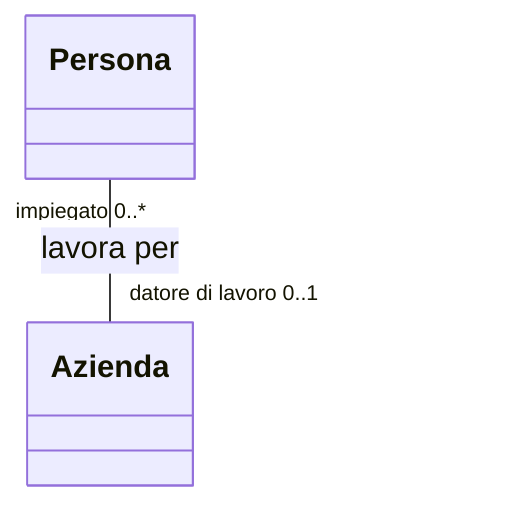

Il ruolo è **opzionale**, tranne quando le **stesse due classi** sono collegate **più volte** o una classe è collegata **a se stessa**: lì il ruolo diventa **obbligatorio**, perché serve a distinguere le associazioni. Esempio: tra `Utente` e `Directory` possono esistere due associazioni diverse, "**owner**" (il proprietario della directory, `1`) e "**utente autorizzato**" (chi può accedervi, `0..*`).

#### Classe di associazione

A volte un'informazione non appartiene a nessuna delle due classi, ma **al legame** tra loro. Esempio: tra `Studente` e `Corso` esiste una relazione "è iscritto a", e il **voto d'esame** non è un attributo di `Studente` (ne ha uno per ogni corso) né di `Corso` (ne ha uno per ogni studente): appartiene alla **coppia**.

Si risolve con una **classe di associazione** (`Iscrizione`, con l'attributo `voto`), collegata alla linea con un tratteggio. In Java si realizza di solito con una classe vera e propria che contiene un riferimento a entrambe.

#### Classe di associazione: il vincolo implicito e altri esempi

Una classe di associazione serve quando si vogliono aggiungere **attributi a un'associazione** invece che a una delle classi coinvolte. Si disegna come una normale classe, collegata alla linea dell'associazione con un **tratteggio**.

Esempio 1: tra `Persona` e `Datore di lavoro` (molteplicità `*` e `*`) la classe associativa `Impiego` contiene l'attributo `periodo`.

Esempio 2: tra `Studente` e `Corso` (`1..*` e `1..*`) la classe associativa `Frequenza` contiene `anno_accademico` e `profitto`. Questi **non** sono attributi di `Studente` (cambiano da corso a corso) e **non** sono attributi di `Corso` (ogni corso è frequentato da studenti diversi in anni diversi): appartengono al **legame**.

```mermaid
classDiagram
    class Studente
    class Corso
    class Frequenza {
        -annoAccademico: int
        -profitto: int
    }
    Studente "1..*" -- "1..*" Corso
    (Studente, Corso) .. Frequenza
```

**Perché esistono le classi associative?** Perché sottintendono un **vincolo aggiuntivo**: tra ogni coppia di oggetti associati può esistere **una sola istanza** della classe associativa. Se uno studente potesse frequentare lo stesso corso più volte (con più "profitto"), questa soluzione non andrebbe bene e servirebbe una classe normale.

### 6.2 La molteplicità

La **molteplicità** (o *cardinalità*) dice **quanti oggetti** possono partecipare alla relazione.

| Notazione | Significato | Esempio |
|---|---|---|
| `1` | esattamente uno | ogni studente ha 1 codice fiscale |
| `0..1` | zero o uno (facoltativo) | una persona ha 0 o 1 patente |
| `*` o `0..*` | zero o più | un docente ha 0 o più classi |
| `1..*` | uno o più (almeno uno) | una classe ha almeno 1 studente |
| `2..5` | da due a cinque | una squadra ha da 2 a 5 giocatori |
| `3` | esattamente tre | un triangolo ha 3 lati |

Come si traduce in Java:

- molteplicità **`1`** → un attributo semplice (`private Docente docente;`);
- molteplicità **`0..1`** → un attributo semplice che può valere `null`;
- molteplicità **`*`** o **`1..*`** → una **collezione** (`ArrayList<Studente>`) o un array.

**Come si leggono le molteplicità**, passo per passo: si sceglie una delle due classi, si immagina di prendere *un* oggetto di quella classe e si guarda il numero scritto **dalla parte opposta**: indica quanti oggetti dell'altra classe gli sono collegati.

#### Notazioni avanzate per la molteplicità

La molteplicità può essere precisa quanto serve: si possono combinare valori singoli e intervalli separandoli con una virgola.

| Notazione | Significato |
|---|---|
| `1` | esattamente una |
| `0..1` | zero o una |
| `0..*` | zero o più |
| `0, 3..5, 7..*` | zero, oppure da 3 a 5, oppure 7 o più |
| `1..3, 5` | 1, 2, 3 oppure 5 (ma **non** 4) |

Esistono varie convenzioni per scrivere le molteplicità (per esempio la notazione dei database `(0,1)`, `(1,N)`): `(0,1)` equivale a `0..1`, `(1,N)` a `1..*`, `1..1` a `1`, `0..*` a `*`.

Esempio: *"Ogni auto ha 1, 2, 3 o 5 (ma non 4) comproprietari; ogni persona può possedere zero o al più un'auto (magari in comproprietà)"* diventa:

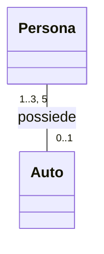

#### Partecipazione obbligatoria e facoltativa

Una classe partecipa **obbligatoriamente** a un'associazione se la sua molteplicità minima è almeno `1`, **facoltativamente** se il minimo è `0`.

- `Cliente` `1` — `*` `Ordine`: un cliente può fare quanti ordini vuole, anche nessuno (`*`); ogni ordine deve avere **uno e un solo** cliente. `Ordine` partecipa **obbligatoriamente**.
- `Poligono` `0..1` — `3..*` `Punto`: un poligono ha almeno 3 punti; ogni punto fa parte di un poligono o di nessuno, ma **non di più di uno**. `Punto` partecipa **facoltativamente**.
- `Squadra` `1` — `16..22` `Calciatore`: ogni squadra ha da 16 a 22 calciatori.

### 6.3 Aggregazione

L'**aggregazione** è un'associazione particolare che esprime la relazione **"ha un"** / **"è composto da"** tra un **intero** e le sue **parti**, dove le parti **possono esistere anche senza l'intero**. Si disegna con un **rombo vuoto** dalla parte dell'**intero**.

Esempio: una `Squadra` è un'aggregazione di `Giocatore`. Se la squadra si scioglie, i giocatori continuano a esistere (e possono entrare in un'altra squadra).

```
Squadra <>------------ 1..* Giocatore
 (il rombo vuoto sta dal lato dell'intero, la Squadra)
```

In Java le parti vengono **create fuori** dall'intero e **passate** a esso:

```java
public class Squadra {
    private ArrayList<Giocatore> giocatori = new ArrayList<>();

    public void aggiungiGiocatore(Giocatore g) {   // il giocatore arriva dall'esterno
        giocatori.add(g);
    }
}
```

**Come si legge:** il rombo vuoto si legge **"è un insieme di"**. Esempio dalle slide: un'automobile *ha* un motore e quattro ruote; sia il motore sia le ruote hanno **dignità ed esistenza propria** anche fuori dall'automobile, e la distruzione dell'automobile **non** comporta automaticamente quella delle sue parti.

Poiché è un'associazione particolare, si può **sempre** indicare la molteplicità (`Poligono` ◇——`1..*` `Punto`). Il modello è **equivalente** a un'associazione convenzionale con nome "*InsiemeDi*" tra le due classi: il rombo è un modo più espressivo di dire la stessa cosa.

### 6.4 Composizione

La **composizione** è una forma **più forte** di aggregazione: le parti **non possono esistere senza l'intero**, nascono e muoiono con lui, e appartengono a **un solo** intero. Si disegna con un **rombo pieno** dalla parte dell'**intero**.

Esempio: una `Casa` è composta da `Stanza`. Se la casa viene demolita, le stanze spariscono con lei: una stanza da sola non ha senso.

```
Casa <#>------------ 1..* Stanza
 (il rombo pieno sta dal lato dell'intero, la Casa)
```

In Java l'intero **crea al proprio interno** le parti e nessun altro le possiede:

```java
public class Casa {
    private ArrayList<Stanza> stanze = new ArrayList<>();

    public Casa() {
        stanze.add(new Stanza("cucina"));    // la Casa crea le sue Stanze
        stanze.add(new Stanza("bagno"));
    }
}
```

#### Le proprietà della composizione

- Significa **"è composto da"**.
- I componenti **non possono esistere** senza il contenitore.
- La proprietà del contenitore è **esclusiva**: una parte appartiene a **un solo** intero (la molteplicità dal lato dell'intero è sempre `1`; dal lato delle parti può essere qualsiasi).
- Parti e intero hanno lo **stesso ciclo di vita**: quando l'oggetto principale viene distrutto, la distruzione **si propaga** agli oggetti parte.

**Esempio: la finestra (`Window`).** Una `Window` è composta da 2 `Slider` (ruolo *scrollbar*), 1 `Panel` (ruolo *body*) e 1 `Button` (ruolo *close*).

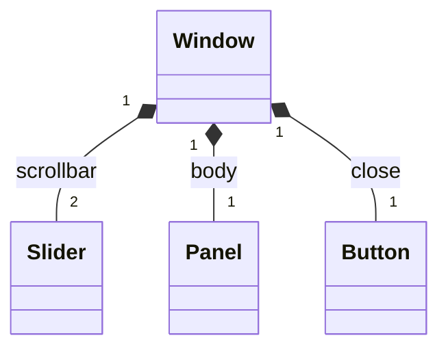

```java
public class Window {
    private Slider[] scrollbar = { new Slider(), new Slider() };   // 2 slider, creati qui
    private Panel body = new Panel();
    private Button close = new Button();
}
```

#### Composizione e aggregazione insieme: Poligono, Punto, Stile

Un `Poligono` ha almeno 3 `Punto` (composizione) e ha uno `Stile` (colore, pieno), che può essere **condiviso** con altre figure, per esempio un `Cerchio` (aggregazione).

- Cancellando un `Poligono` si cancellano anche tutti i suoi `Punto` (composizione, rombo **pieno**).
- Lo `Stile` **non** viene cancellato, perché può servire anche a un `Cerchio` (aggregazione, rombo **vuoto**).

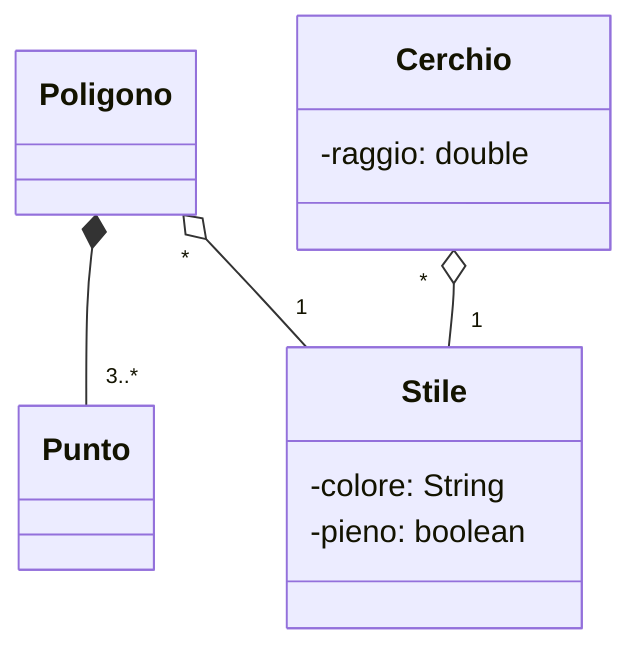

#### La notazione ad albero

Per non riempire il diagramma di linee di aggregazione e composizione si può usare una notazione ad **albero**: un solo rombo sulla classe-intero da cui partono i rami verso le parti, ciascuno con la sua molteplicità. Esempio: un `PC` è composto da `Monitor` (`1..*`), `UnitàBase`, `Mouse` (`0..1`) e `Tastiera`; a sua volta l'`UnitàBase` è composta da `HardDisk` (`1..4`), `ModuloRAM` (`1..4`), `CPU` (`1..2`) e `Coprocessore` (`0..1`).

### 6.5 Come distinguere associazione, aggregazione e composizione

| | Associazione | Aggregazione | Composizione |
|---|---|---|---|
| Significato | "conosce / usa" | "ha un" (parti indipendenti) | "è fatto di" (parti dipendenti) |
| Simbolo | linea semplice | rombo **vuoto** | rombo **pieno** |
| Le parti esistono senza l'intero? | sì, legame debole | **sì** | **no** |
| Chi crea le parti? | chiunque | di solito **dall'esterno** | di solito **l'intero** stesso |
| Una parte può appartenere a più interi? | sì | sì | **no**, a uno solo |
| Esempio | Docente — Studente | Squadra — Giocatore | Casa — Stanza |

**Trucco per decidere:** chiediti *"se elimino l'intero, le parti hanno ancora senso da sole?"*. Se **sì** → aggregazione; se **no** → composizione. Se non c'è nemmeno un rapporto "intero-parte" ma solo un collegamento → associazione semplice.

> Nota: nella pratica la differenza tra associazione e aggregazione è molto sottile, e perfino l'UML stesso la considera poco rilevante. Se hai dubbi tra le due, usa l'associazione semplice. La distinzione che conta davvero è quella tra **aggregazione e composizione** (il ciclo di vita delle parti).

### 6.6 Generalizzazione (ereditarietà)

La **generalizzazione** esprime la relazione **"è un"** (*is-a*) tra una **superclasse** (più generale) e una **sottoclasse** (più specifica). Si disegna con una **linea continua** terminante con un **triangolo vuoto** rivolto verso la **superclasse**.

Esempio: `Studente` e `Docente` sono entrambi una `Persona`.

```
              Persona
                 ^
         +-------+-------+
         |               |
     Studente         Docente
```

La sottoclasse **eredita** tutti gli attributi e i metodi della superclasse (tranne quelli privati, che esistono ma non sono accessibili direttamente) e può:

- **aggiungere** attributi e metodi propri;
- **ridefinire** (*override*) metodi ereditati per cambiarne il comportamento.

In Java si usa `extends`, e il costruttore della sottoclasse chiama quello della superclasse con `super(...)`:

```java
public class Persona {
    protected String nome;

    public Persona(String nome) {
        this.nome = nome;
    }

    public String presentati() {
        return "Sono " + nome;
    }
}

public class Studente extends Persona {
    private int matricola;

    public Studente(String nome, int matricola) {
        super(nome);                       // chiama il costruttore di Persona
        this.matricola = matricola;
    }

    @Override
    public String presentati() {           // ridefinizione (override)
        return super.presentati() + " e ho la matricola " + matricola;
    }
}
```

Nel diagramma gli attributi e i metodi **ereditati non si ripetono** nella sottoclasse: si disegnano solo quelli **nuovi** o **ridefiniti**.

#### Il polimorfismo

Grazie all'ereditarietà, una variabile del tipo della superclasse può contenere un oggetto di una qualsiasi sottoclasse, e il metodo che viene eseguito è quello **della classe reale dell'oggetto**:

```java
Persona p1 = new Persona("Anna");
Persona p2 = new Studente("Marco", 1234);

System.out.println(p1.presentati());   // "Sono Anna"
System.out.println(p2.presentati());   // "Sono Marco e ho la matricola 1234"
```

Questo si chiama **polimorfismo** ("molte forme"): lo stesso messaggio (`presentati()`) produce comportamenti diversi a seconda dell'oggetto che lo riceve.

#### Quando usare l'ereditarietà

Usala solo quando la frase **"A è un B"** ha davvero senso e quando la sottoclasse rispetta **tutto** ciò che promette la superclasse. "Uno `Studente` è una `Persona`" ha senso. "Una `Pila` è una `Lista`" è dubbio. "Un `Motore` è un'`Auto`" è sbagliato: un'auto *ha* un motore.

#### Alcune proprietà in più della generalizzazione

- **Ogni istanza di una classe è anche istanza di tutte le sue superclassi**: un oggetto `Studente` è anche una `Persona`, e quindi può essere trattato esattamente come una `Persona`.
- La generalizzazione non vale solo per le classi: in UML si può usare anche tra altri elementi (package, casi d'uso...).
- **Ereditarietà** è il meccanismo con cui gli elementi specializzati **incorporano la struttura e il comportamento** di quelli più generali.
- La sottoclasse può differenziarsi dalla superclasse **aggiungendo** attributi e metodi o **ridefinendo** i metodi.

**Altri esempi:**

| Superclasse | Sottoclassi | Che cosa aggiungono |
|---|---|---|
| `Poligono` (colore; `sposta()`, `ruota()`, `disegna()`) | `Rettangolo`, `Triangolo` | `Rettangolo` aggiunge `diagonale()` |
| `Autoveicolo` (targa, modello; `stampaLibretto()`) | `VeicoloPrivato`, `VeicoloCommerciale` | privato: `numeroPorte`, `numeroPosti`; commerciale: `pesoCarico`, `pesoVuoto`, `articolato` |
| `Persona` (data di nascita) | `Uomo`, `Donna` | `Uomo`: posizione militare; `Donna`: numero gravidanze |

#### Il principio di sostituzione

> In una generalizzazione, una classe figlia deve rappresentare un **valido sostituto** della classe padre: in qualunque punto del codice in cui appare la classe padre, deve essere possibile **sostituirla con la classe figlia**. Il viceversa **non** è vero.

Si chiama **principio di sostituzione di Liskov** ed è un ottimo test per scoprire generalizzazioni sbagliate.

- Corretto: ovunque serve una `Persona` posso usare uno `Studente` (lo studente sa fare tutto ciò che sa fare una persona).
- Non vale il contrario: dove serve uno `Studente` (per esempio per leggere la `matricola`) non posso usare una `Persona` qualsiasi.
- **Esempio di errore:** se `Pinguino` estende `Uccello` e `Uccello` ha il metodo `vola()`, il pinguino non può sostituire l'uccello senza problemi, perché non vola. La generalizzazione è sbagliata: forse serve una classe `UccelloVolatore`, oppure `vola()` non va messo in `Uccello`.

### 6.7 Classi astratte

Una **classe astratta** è una classe che **non può essere istanziata** direttamente: serve solo come base comune per altre classi. Può contenere:

- metodi **normali** (con corpo), che le sottoclassi ereditano;
- metodi **astratti** (senza corpo), che le sottoclassi **devono** implementare.

Nel diagramma il nome è in *corsivo* oppure con lo stereotipo `<<abstract>>`. In Java:

```java
public abstract class Figura {
    protected String colore;

    public Figura(String colore) {
        this.colore = colore;
    }

    public abstract double area();         // niente corpo: lo decidono le sottoclassi

    public String getColore() {            // metodo normale, ereditato
        return colore;
    }
}

public class Cerchio extends Figura {
    private double raggio;

    public Cerchio(String colore, double raggio) {
        super(colore);
        this.raggio = raggio;
    }

    @Override
    public double area() {
        return Math.PI * raggio * raggio;
    }
}
```

Scrivere `new Figura("rosso")` produce un errore di compilazione: una "figura generica" non esiste, esistono solo cerchi, quadrati, triangoli.

### 6.8 Interfacce e realizzazione

Un'**interfaccia** definisce un **contratto**: l'elenco dei metodi che una classe **deve** avere, senza dire *come* sono fatti. Nel diagramma ha lo stereotipo `<<interface>>`.

La **realizzazione** è il legame tra una classe e l'interfaccia che **implementa**. Si disegna con una **linea tratteggiata** terminante con un **triangolo vuoto** rivolto verso l'interfaccia. In Java si usa `implements`.

```java
public interface Stampabile {
    void stampa();
}

public class Libro implements Stampabile {
    private String titolo;

    @Override
    public void stampa() {
        System.out.println("Libro: " + titolo);
    }
}
```

Una classe può implementare **più interfacce** (`class Libro implements Stampabile, Prestabile`), mentre in Java può estendere **una sola** classe. Anche le interfacce possono estendersi tra loro.

#### Classe astratta o interfaccia?

| | Classe astratta | Interfaccia |
|---|---|---|
| Parola chiave in Java | `abstract class` / `extends` | `interface` / `implements` |
| Quanti se ne possono ereditare/implementare | **una sola** classe astratta | **molte** interfacce |
| Può avere attributi (variabili d'istanza)? | sì | no, solo costanti |
| Può avere metodi con corpo? | sì | solo `default` e `static` |
| Esprime | una **base comune** ("è un") | una **capacità** ("sa fare") |
| Esempio | `Figura`, `Veicolo` | `Stampabile`, `Comparable` |

#### Notazione lollipop ed esempio della tastiera

Oltre al rettangolo con `<<interface>>`, un'interfaccia si può rappresentare in modo compatto con un **piccolo cerchio** collegato alla classe che la realizza: è la **notazione lollipop** ("a lecca-lecca"), in cui la realizzazione è una semplice linea.

- Un'interfaccia **non ha attributi**, solo operazioni; rappresenta l'insieme di operazioni che una classe **offre ad altre classi**.
- La realizzazione è una **linea tratteggiata** con un **triangolo largo e vuoto** dal lato dell'**interfaccia**.

**Esempio:** la tastiera di un computer realizza l'interfaccia `MacchinaDaScrivere`, che definisce l'operazione `keyStroke()`. La `Tastiera` la implementa, ma ha anche operazioni **che l'interfaccia non prevede** (`ctrl()`, `alt()`, `pgUp()`, `pgDn()`...).

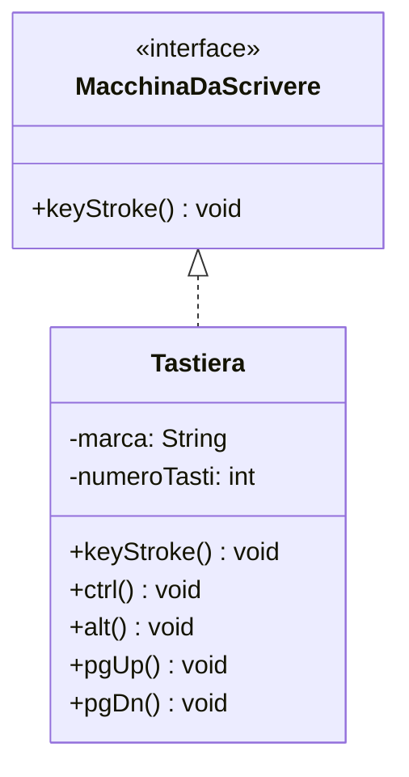

Una classe che implementa un'interfaccia **deve** realizzare tutte le sue operazioni, ma può **aggiungerne altre**.

### 6.9 Dipendenza

La **dipendenza** è la relazione **più debole**: una classe **usa** un'altra solo in modo temporaneo (per esempio la riceve come parametro di un metodo, la restituisce o la crea come variabile locale), ma **non la conserva come attributo**. Si disegna con una **linea tratteggiata e una freccia aperta** verso la classe da cui si dipende.

```java
public class Registro {
    public void stampaScheda(Studente s) {      // Registro dipende da Studente
        System.out.println(s.getNome());
    }
}
```

**Differenza con l'associazione:** nell'associazione la classe *conserva* un riferimento (attributo) all'altra; nella dipendenza la usa solo *durante l'esecuzione di un metodo*. Se la modifichi, però, può rompere la classe che dipende da essa.

### 6.10 Riepilogo delle relazioni

| Relazione | Significato | Simbolo | In Java |
|---|---|---|---|
| Associazione | "conosce / usa" | linea continua (con freccia se unidirezionale) | attributo riferimento |
| Aggregazione | "ha un" (parti indipendenti) | rombo **vuoto** | attributo; parti create all'esterno |
| Composizione | "è fatto di" (parti dipendenti) | rombo **pieno** | attributo; parti create con `new` all'interno |
| Generalizzazione | "è un" | linea continua + triangolo vuoto | `extends` |
| Realizzazione | "implementa" | linea tratteggiata + triangolo vuoto | `implements` |
| Dipendenza | "usa temporaneamente" | linea tratteggiata + freccia aperta | parametro / variabile locale |

**Scala della "forza" del legame** (dal più debole al più forte):

> dipendenza < associazione < aggregazione < composizione

L'ereditarietà è un legame fortissimo, perché la sottoclasse è **vincolata** alla superclasse: una modifica alla superclasse si ripercuote su tutte le sottoclassi.

---

## 7. Altri elementi del class diagram

### 7.1 Stereotipi

Uno **stereotipo** è un'etichetta tra virgolette angolari (`<< >>`) che specifica il "tipo" di un elemento. I più comuni:

| Stereotipo | Uso |
|---|---|
| `<<interface>>` | interfaccia |
| `<<abstract>>` | classe astratta |
| `<<enumeration>>` | enumerazione (`enum`) |
| `<<utility>>` | classe con soli metodi statici (es. `Math`) |

### 7.2 Enumerazioni

Un'**enumerazione** è un tipo con un insieme fisso di valori. Si disegna come una classe con lo stereotipo `<<enumeration>>` e i valori elencati nel compartimento centrale.

```java
public enum StatoPrestito {
    IN_CORSO, RESTITUITO, IN_RITARDO
}
```

### 7.3 Note e vincoli

Per aggiungere un commento al diagramma si usa una **nota**: un rettangolo con l'angolo piegato, collegato con una linea tratteggiata all'elemento a cui si riferisce. I **vincoli** si scrivono tra parentesi graffe, per esempio `{ordinato}` su una collezione, oppure `{saldo >= 0}` su un attributo.

#### Esempi di vincoli

Per rendere il diagramma più comprensibile si possono scrivere **vincoli aggiuntivi** tra **parentesi graffe**, accanto alla classe o all'associazione, in **linguaggio naturale** o **pseudocodice**. Possono riguardare sia i legami sia i valori degli attributi.

- `{if Ordine.cliente.credito è "basso" allora Ordine.prepagato deve essere true}`: collegato a `Ordine` con una linea tratteggiata.
- `{credito() == "basso"}`: accanto alla sottoclasse `Privato`.
- `{if Corso di Laurea = Informatica allora Matricola = 0801...}`: su `Studente` del vecchio ordinamento.

### 7.4 Package

Un **package** raggruppa classi correlate (come i package di Java) e si disegna come una cartella. Serve a organizzare diagrammi grandi.

---

## 8. Esempi completi

Il diagramma di ogni esempio è scritto in **Mermaid**: puoi incollarlo su [mermaid.live](https://mermaid.live) per vederlo disegnato ed esportarlo come immagine. Legenda della sintassi: `<|--` ereditarietà, `<|..` realizzazione, `*--` composizione, `o--` aggregazione, `--` associazione, `..>` dipendenza.

### 8.1 Esempio 1: la biblioteca scolastica

**Requisiti.** Una biblioteca possiede molti libri. Ogni libro ha titolo, autore e codice. Gli utenti (studenti e docenti, che sono entrambi persone) possono prendere in prestito più libri. Un prestito collega un utente a un libro e ha una data. I libri si possono stampare.

**Passo 1, le classi (i sostantivi):** `Biblioteca`, `Libro`, `Persona`, `Studente`, `Docente`, `Prestito`, `Stampabile`.

**Passo 2, attributi e metodi (le informazioni e le azioni):** `titolo`, `autore`, `codice`, `dataPrestito`; `aggiungiLibro()`, `prestaLibro()`, `restituisci()`.

**Passo 3, le relazioni (i verbi):**

- la `Biblioteca` **possiede** molti `Libro` → composizione (senza biblioteca il catalogo non ha senso);
- `Studente` e `Docente` **sono** `Persona` → generalizzazione;
- un `Prestito` **collega** una `Persona` e un `Libro` → due associazioni;
- `Libro` **implementa** `Stampabile` → realizzazione.

**Passo 4, il diagramma:**

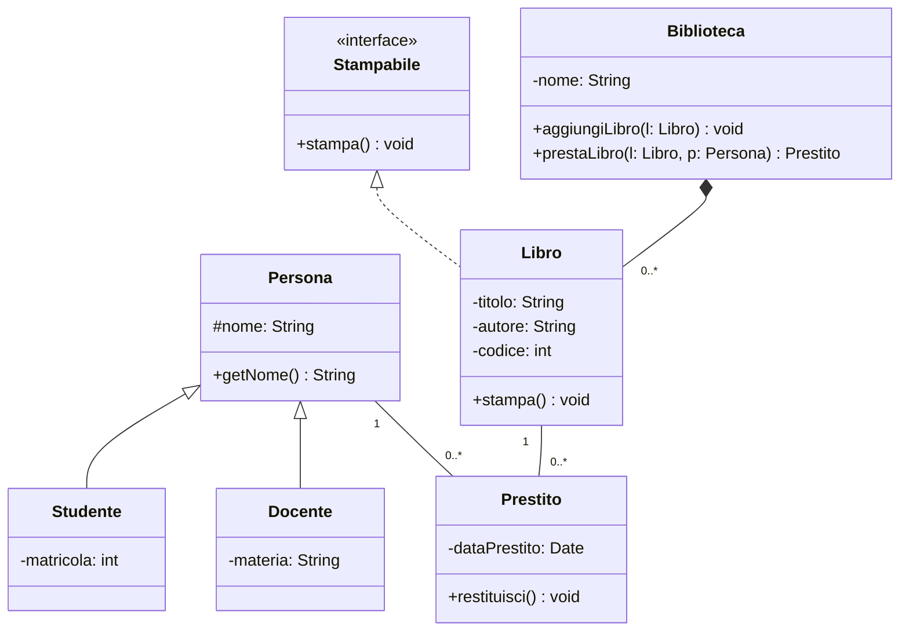

**Passo 5, il codice Java:**

```java
import java.util.ArrayList;
import java.util.Date;

public interface Stampabile {
    void stampa();
}

public class Persona {
    protected String nome;
    public Persona(String nome) { this.nome = nome; }
    public String getNome() { return nome; }
}

public class Studente extends Persona {
    private int matricola;
    public Studente(String nome, int matricola) {
        super(nome);
        this.matricola = matricola;
    }
}

public class Docente extends Persona {
    private String materia;
    public Docente(String nome, String materia) {
        super(nome);
        this.materia = materia;
    }
}

public class Libro implements Stampabile {
    private String titolo;
    private String autore;
    private int codice;

    public Libro(String titolo, String autore, int codice) {
        this.titolo = titolo;
        this.autore = autore;
        this.codice = codice;
    }

    @Override
    public void stampa() {
        System.out.println(titolo + " di " + autore);
    }
}

public class Prestito {
    private Persona persona;       // associazione verso Persona
    private Libro libro;           // associazione verso Libro
    private Date dataPrestito;

    public Prestito(Persona persona, Libro libro) {
        this.persona = persona;
        this.libro = libro;
        this.dataPrestito = new Date();
    }

    public void restituisci() {
        // logica di restituzione...
    }
}

public class Biblioteca {
    private String nome;
    private ArrayList<Libro> libri = new ArrayList<>();      // composizione

    public Biblioteca(String nome) { this.nome = nome; }

    public void aggiungiLibro(Libro l) {
        libri.add(l);
    }

    public Prestito prestaLibro(Libro l, Persona p) {
        return new Prestito(p, l);
    }
}
```

### 8.2 Esempio 2: i conti bancari (classe astratta e polimorfismo)

**Requisiti.** Una banca gestisce due tipi di conto: il conto corrente e il conto risparmio. Ogni conto ha un numero e un saldo e permette di versare e prelevare. Il conto corrente può andare in "scoperto" fino a un fido; il conto risparmio non può mai andare sotto zero e matura interessi. Un conto appartiene a un titolare.

**Ragionamento:** i due conti hanno tante cose in comune (numero, saldo, versamento) → si estrae una **classe astratta** `ContoBancario`. Il prelievo però funziona in modo diverso nei due casi → `preleva()` è un **metodo astratto**, e ogni sottoclasse lo implementa a modo suo.

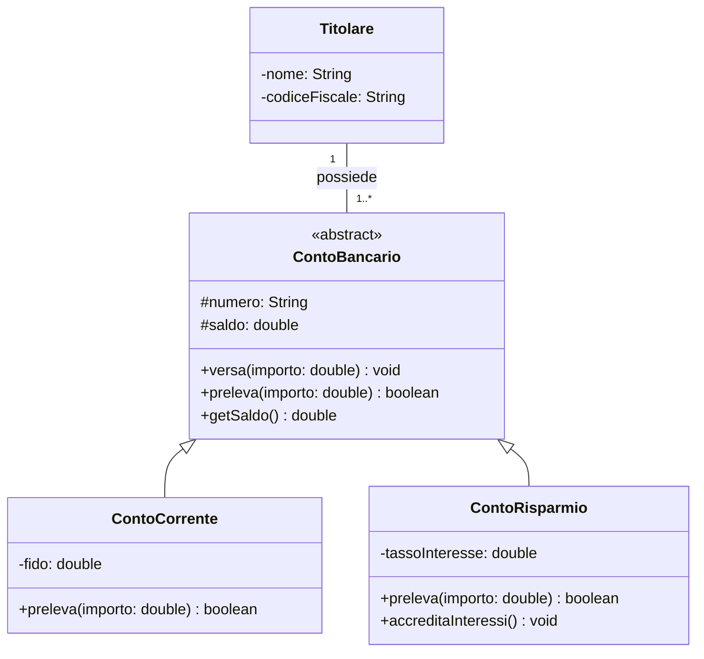

```java
public abstract class ContoBancario {
    protected String numero;
    protected double saldo;

    public ContoBancario(String numero) {
        this.numero = numero;
    }

    public void versa(double importo) {
        if (importo > 0) saldo += importo;
    }

    public double getSaldo() { return saldo; }

    public abstract boolean preleva(double importo);   // lo decidono le sottoclassi
}

public class ContoCorrente extends ContoBancario {
    private double fido;

    public ContoCorrente(String numero, double fido) {
        super(numero);
        this.fido = fido;
    }

    @Override
    public boolean preleva(double importo) {
        if (importo > 0 && saldo + fido >= importo) {   // può andare in scoperto
            saldo -= importo;
            return true;
        }
        return false;
    }
}

public class ContoRisparmio extends ContoBancario {
    private double tassoInteresse;

    public ContoRisparmio(String numero, double tasso) {
        super(numero);
        this.tassoInteresse = tasso;
    }

    @Override
    public boolean preleva(double importo) {
        if (importo > 0 && saldo >= importo) {          // mai sotto zero
            saldo -= importo;
            return true;
        }
        return false;
    }

    public void accreditaInteressi() {
        saldo += saldo * tassoInteresse;
    }
}

public class Main {
    public static void main(String[] args) {
        ArrayList<ContoBancario> conti = new ArrayList<>();
        conti.add(new ContoCorrente("C1", 500));
        conti.add(new ContoRisparmio("R1", 0.02));

        for (ContoBancario c : conti) {
            c.versa(100);
            c.preleva(300);          // polimorfismo: ogni conto usa il proprio preleva()
            System.out.println(c.getSaldo());
        }
    }
}
```

Nel ciclo `for` il programma tratta tutti i conti allo stesso modo (`ContoBancario`), ma sul conto corrente il prelievo di 300 euro **riesce** (grazie al fido), mentre sul conto risparmio **fallisce**. È il polimorfismo in azione.

### 8.3 Esempio 3: ordini e clienti (dalle slide del corso)

**Requisiti.** Un `Cliente` ha nome, indirizzo e un'operazione `credito()` che restituisce il livello di credito. Un cliente può essere un'`Azienda` (con partita IVA) oppure un `Privato` (con codice fiscale). Un `Ordine` ha data, numero, prezzo, il flag `prepagato` e le operazioni `spedisci()` e `chiudi()`; ogni ordine appartiene a un solo cliente e il cliente può fare quanti ordini vuole. Un ordine è formato da più `LineaOrdine`, ciascuna con una quantità, un flag `soddisfatto` e un `Prodotto` (con prezzo). Per le aziende, un `Impiegato` fa da venditore. I clienti privati con credito basso devono pagare l'ordine in anticipo.

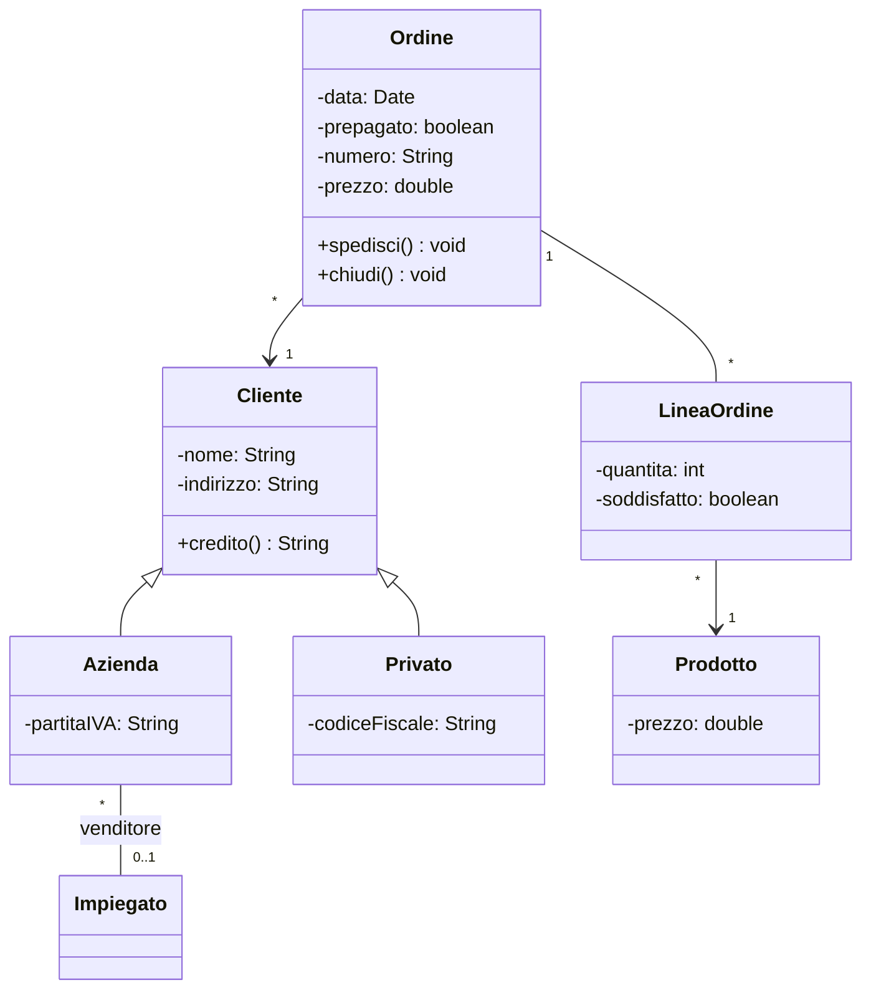

Elementi da notare:

- **Generalizzazione:** `Azienda` e `Privato` sono sottoclassi di `Cliente` (superclasse): ereditano `nome`, `indirizzo` e `credito()`.
- **Navigabilità:** la freccia `Ordine` → `Cliente` indica che l'ordine conosce il suo cliente, ma non il contrario.
- **Molteplicità opzionale:** il venditore `0..1`: non tutte le aziende hanno un impiegato assegnato.
- **Vincolo** su `Ordine`: *se `Ordine.cliente.credito` è "basso", allora `Ordine.prepagato` deve essere `true`*.

---

## 9. Come si costruisce un class diagram

1. **Leggi con attenzione i requisiti** e sottolinea i **sostantivi** (candidate classi) e i **verbi** (candidate relazioni o metodi).
2. **Elimina** i sostantivi che sono solo proprietà di un'altra classe (diventano attributi), i sinonimi e quelli fuori dal problema.
3. **Disegna le classi** come rettangoli con il solo nome.
4. **Aggiungi gli attributi** (con tipo e visibilità, di norma privata) e i **metodi** (di norma pubblici).
5. **Collega le classi** scegliendo la relazione giusta. Chiediti sempre: "è un?" (ereditarietà), "è fatto di?" (composizione/aggregazione), "usa / conosce?" (associazione/dipendenza).
6. **Indica le molteplicità** a entrambi gli estremi di ogni associazione.
7. **Cerca le cose in comune:** se più classi hanno gli stessi attributi o metodi, valuta una superclasse o un'interfaccia.
8. **Rileggi i requisiti** e verifica che ogni frase sia rappresentata nel diagramma, e che non ci siano classi inutili.

---

## 10. Principi di buona progettazione

- **Alta coesione:** ogni classe deve avere **una responsabilità precisa**. Una classe `Studente` che gestisce anche la stampa, il salvataggio su file e l'invio di e-mail è fatta male.
- **Basso accoppiamento:** le classi dovrebbero dipendere il **meno possibile** l'una dall'altra, così una modifica in una non rompe le altre. Meglio una dipendenza che un'associazione, meglio un'associazione che un'ereditarietà, se bastano.
- **Incapsulamento:** attributi privati, accesso tramite metodi.
- **Preferire la composizione all'ereditarietà:** l'ereditarietà crea un legame rigido. Se non c'è un vero rapporto "è un", è meglio che una classe *contenga* un'altra invece di estenderla.
- **Programmare verso le interfacce:** dichiarare le variabili col tipo più generale possibile (`List` invece di `ArrayList`, `Figura` invece di `Cerchio`).
- **Nomi chiari:** classi = sostantivi al singolare con iniziale maiuscola (`Prestito`); metodi = verbi con iniziale minuscola (`calcolaMedia`).

---

## 11. Errori comuni

- Confondere **"è un"** (ereditarietà) con **"ha un"** (composizione/aggregazione). Uno `Studente` *è una* `Persona`; una `Casa` *ha* delle `Stanza`.
- Usare l'ereditarietà solo per **riusare codice**, quando la relazione "è un" non esiste.
- Mettere **attributi pubblici**, violando l'incapsulamento.
- Dimenticare le **molteplicità** sulle associazioni.
- **Duplicare** un'associazione come attributo: se `Studente` è collegato a `Classe` con una linea, non scrivere anche `- classe: Classe` nel rettangolo.
- Girare il **triangolo dell'ereditarietà** dalla parte sbagliata: punta **sempre alla superclasse**.
- Ripetere nella sottoclasse attributi e metodi già ereditati.
- Mettere il **rombo dalla parte sbagliata**: va sempre dal lato dell'**intero**, non della parte.
- Confondere **aggregazione e composizione**: la domanda decisiva è se le parti sopravvivono all'intero.
- Disegnare **oggetti** invece di classi (ad esempio "Marco Rossi" invece di `Studente`).
- Inserire in un solo diagramma **troppi dettagli**: se è illeggibile, va diviso in più diagrammi.

### Due errori tipici di modellazione

**1. Trasformare in classe qualcosa che non è un concetto autonomo.** Una classe rappresenta un concetto **autonomo e importante**. Se il concetto da solo significa poco, forse è un **attributo** di un'altra classe. Esempio: l'**indirizzo** di una persona. Da solo vuol dire poco, ha senso perché è legato alla persona: quindi `Persona` è la classe e `indirizzo` è un suo attributo.

**2. Sbagliare il livello di astrazione di attributi e metodi.** Bisogna mantenere il giusto livello. In una classe `Persona`, invece di avere i metodi `trovaVia()`, `trovaNumeroCivico()` e `trovaCap()` conviene un unico metodo `trovaIndirizzoCompleto()`.

Quando leggi le specifiche non sempre è chiaro che cosa meriti di essere una classe: chiediti se il concetto ha **vita propria**, **attributi propri** e **relazioni con altri concetti**.

---

## 12. Strumenti per disegnare i diagrammi

| Strumento | Caratteristiche |
|---|---|
| **draw.io (diagrams.net)** | gratuito, nel browser, si integra con Google Drive; ha le forme UML già pronte |
| **Mermaid** (mermaid.live) | si scrive il diagramma come testo e si ottiene subito il disegno; molto semplice |
| **PlantUML** | simile a Mermaid, più potente, molto usato anche in ambito professionale |
| **StarUML / Visual Paradigm / Lucidchart** | programmi completi per progetti grandi |
| **IDE** (IntelliJ IDEA, Eclipse, NetBeans) | molti possono generare il diagramma direttamente dal codice Java |

---

## 13. Esercizi con soluzione

### Esercizio 1: riconoscere le relazioni

Per ciascuna frase indica la relazione UML più adatta.

1. Un `Gatto` è un `Animale`.
2. Un'`Automobile` ha un `Motore` (il motore è costruito dentro l'auto e non viene mai separato).
3. Una `Squadra` ha dei `Giocatore` (i giocatori esistono anche se la squadra si scioglie).
4. Un `Cliente` effettua degli `Ordine`.
5. Il metodo `stampa(Stampante s)` della classe `Report` riceve una `Stampante` come parametro, senza conservarla.
6. `ArrayList` implementa l'interfaccia `List`.
7. Un `Libro` ha esattamente un `Autore`, e un `Autore` può aver scritto da 0 a molti libri.

**Soluzione:**

1. **Generalizzazione** (`Gatto` → `Animale`, triangolo vuoto verso `Animale`).
2. **Composizione** (rombo pieno dal lato di `Automobile`).
3. **Aggregazione** (rombo vuoto dal lato di `Squadra`).
4. **Associazione** `Cliente 1 — 0..* Ordine`.
5. **Dipendenza** (`Report` ⇢ `Stampante`, tratteggio con freccia).
6. **Realizzazione** (tratteggio con triangolo vuoto verso `List`).
7. **Associazione** `Libro 0..* — 1 Autore`.

### Esercizio 2: dal diagramma al codice

Dato il diagramma:

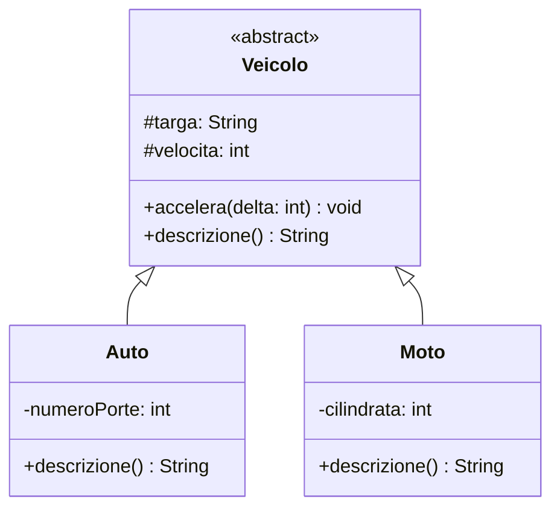

Scrivi il codice Java delle tre classi.

**Soluzione:**

```java
public abstract class Veicolo {
    protected String targa;
    protected int velocita;

    public Veicolo(String targa) {
        this.targa = targa;
    }

    public void accelera(int delta) {
        velocita += delta;
    }

    public abstract String descrizione();
}

public class Auto extends Veicolo {
    private int numeroPorte;

    public Auto(String targa, int numeroPorte) {
        super(targa);
        this.numeroPorte = numeroPorte;
    }

    @Override
    public String descrizione() {
        return "Auto " + targa + " a " + numeroPorte + " porte";
    }
}

public class Moto extends Veicolo {
    private int cilindrata;

    public Moto(String targa, int cilindrata) {
        super(targa);
        this.cilindrata = cilindrata;
    }

    @Override
    public String descrizione() {
        return "Moto " + targa + " da " + cilindrata + " cc";
    }
}
```

### Esercizio 3: dai requisiti al diagramma

**Requisiti.** Un negozio online ha dei clienti. Un cliente può fare molti ordini; ogni ordine appartiene a un solo cliente. Un ordine è formato da una o più righe d'ordine; ogni riga indica un prodotto e la quantità ordinata. Un prodotto ha nome e prezzo e può comparire in molte righe di ordini diversi. Se un ordine viene cancellato, le sue righe vengono cancellate con lui.

**Soluzione:**

- **Classi:** `Cliente`, `Ordine`, `RigaOrdine`, `Prodotto`.
- `Cliente 1 — 0..* Ordine`: associazione.
- `Ordine` → `RigaOrdine` con `1..*`: **composizione** (le righe muoiono con l'ordine).
- `RigaOrdine 0..* — 1 Prodotto`: associazione (il prodotto esiste anche senza righe).

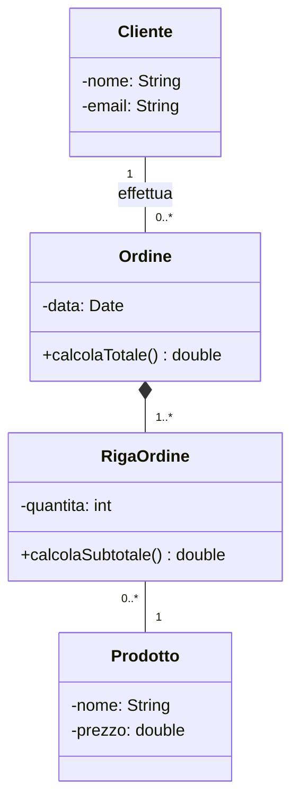

### Esercizio 4: leggere le molteplicità

Dato il diagramma `Persona` `1..3, 5` — *possiede* — `0..1` `Auto`, rispondi:

1. Una persona può possedere due auto?
2. Un'auto può essere posseduta da quattro persone?
3. Un'auto può non avere proprietari?
4. Un'auto può avere cinque comproprietari?

**Soluzione.** Le molteplicità si leggono guardando il numero **dalla parte opposta** della classe di cui parliamo.

1. **No**: il numero accanto ad `Auto` è `0..1`, quindi una persona possiede al massimo **un'auto** (magari in comproprietà).
2. **No**: il numero accanto a `Persona` è `1..3, 5`, quindi i proprietari possono essere 1, 2, 3 o 5, ma non 4.
3. **No**: il minimo è 1, quindi ogni auto ha almeno un proprietario.
4. **Sì**: 5 è tra i valori ammessi.

### Esercizio 5: il principio di sostituzione

Per ciascuna generalizzazione dì se rispetta il principio di sostituzione.

1. `Studente` estende `Persona`.
2. `Quadrato` estende `Rettangolo`, dove `Rettangolo` ha `setLarghezza()` e `setAltezza()` indipendenti.
3. `Pinguino` estende `Uccello`, dove `Uccello` ha `vola()`.
4. `ContoRisparmio` estende `ContoBancario`.

**Soluzione.**

1. **Rispetta**: uno studente può fare tutto ciò che fa una persona.
2. **Non rispetta**: un quadrato non può cambiare larghezza e altezza in modo indipendente, quindi dove il codice si aspetta un rettangolo (con lati liberi) il quadrato si comporta in modo diverso e può causare errori.
3. **Non rispetta**: il pinguino non vola, quindi non può sostituire un uccello in un codice che chiama `vola()`.
4. **Rispetta**: un conto risparmio è un valido conto bancario (versa, preleva, ha un saldo).

## 15. Glossario

| Termine | Significato |
|---|---|
| **UML** | Unified Modeling Language, linguaggio grafico standard per modellare il software |
| **Class diagram** | diagramma UML che mostra classi e relazioni |
| **Classe** | modello che descrive dati e operazioni di un tipo di oggetti |
| **Oggetto / istanza** | esemplare concreto di una classe |
| **Attributo** | dato contenuto in una classe (variabile d'istanza) |
| **Metodo / operazione** | azione che un oggetto sa compiere |
| **Visibilità** | chi può accedere a un attributo o metodo (`+ - # ~`) |
| **Incapsulamento** | nascondere i dati e rendere accessibili solo i metodi necessari |
| **Associazione** | collegamento tra due classi |
| **Molteplicità** | quanti oggetti partecipano a una relazione |
| **Navigabilità** | verso in cui una classe conosce l'altra |
| **Aggregazione** | "ha un" con parti indipendenti dall'intero |
| **Composizione** | "è fatto di" con parti che dipendono dall'intero |
| **Generalizzazione** | relazione "è un" tra superclasse e sottoclasse |
| **Superclasse / sottoclasse** | classe generale / classe specializzata che la estende |
| **Override** | ridefinizione in una sottoclasse di un metodo ereditato |
| **Overloading** | più metodi con lo stesso nome ma parametri diversi |
| **Classe astratta** | classe non istanziabile, base per altre classi |
| **Interfaccia** | contratto: elenco di metodi che una classe deve implementare |
| **Realizzazione** | legame tra una classe e l'interfaccia che implementa |
| **Dipendenza** | uso temporaneo di una classe da parte di un'altra |
| **Polimorfismo** | stesso metodo, comportamenti diversi a seconda dell'oggetto |
| **Stereotipo** | etichetta `<< >>` che precisa il tipo di un elemento |
| **Coesione** | quanto una classe ha una sola responsabilità ben definita |
| **Accoppiamento** | quanto una classe dipende dalle altre |
| **Schema concettuale** | descrizione valida per tutte le istanze, indipendente dall'implementazione |
| **Prospettiva concettuale / di specifica / implementativa** | tre livelli di precisione con cui si può disegnare lo stesso diagramma |
| **Principio di sostituzione (Liskov)** | la sottoclasse deve poter sostituire la superclasse ovunque |
| **Classe associativa** | classe collegata a un'associazione, che ne contiene gli attributi |
| **Ruolo** | parte che una classe svolge in un'associazione (es. "datore di lavoro") |
| **Partecipazione obbligatoria / facoltativa** | molteplicità minima almeno 1 / uguale a 0 |
| **Vincolo** | condizione scritta tra `{ }` in linguaggio naturale o pseudocodice |
| **Notazione lollipop** | rappresentazione compatta dell'interfaccia con un piccolo cerchio |
| **Navigabilità** | verso in cui una classe "conosce" l'altra (freccia sull'associazione) |

---

## 16. Schema di ripasso

**Struttura di una classe:** nome / attributi / metodi.

**Visibilità:** `+` pubblico · `-` privato · `#` protetto · `~` package.

**Le relazioni a colpo d'occhio:**

| Se la frase è... | Relazione | Simbolo |
|---|---|---|
| "A **è un** B" | generalizzazione | linea + triangolo vuoto → B |
| "A **implementa** B" | realizzazione | tratteggio + triangolo vuoto → B |
| "A **è fatto di** B (B muore con A)" | composizione | rombo **pieno** sul lato di A |
| "A **ha** B (B vive anche senza A)" | aggregazione | rombo **vuoto** sul lato di A |
| "A **conosce / usa** B" | associazione | linea (+ molteplicità) |
| "A usa B **solo in un metodo**" | dipendenza | tratteggio + freccia aperta → B |

**Da UML a Java:** attributo → variabile · associazione → attributo riferimento · `0..*` → `ArrayList` · generalizzazione → `extends` · realización → `implements` · dipendenza → parametro/variabile locale.

**Per costruire un diagramma:** sostantivi → classi · verbi → relazioni e metodi · "è un?" / "ha un?" / "usa?" per scegliere la relazione · molteplicità su ogni associazione.

**Da ricordare in plus:**
- **Composizione:** parti con lo stesso ciclo di vita dell'intero, proprietà **esclusiva**, molteplicità `1` dal lato dell'intero, la distruzione si **propaga**.
- **Aggregazione:** "è un insieme di", parti con esistenza propria, anche condivisibili.
- **Generalizzazione:** ogni istanza è anche istanza di tutte le superclassi; verifica sempre il **principio di sostituzione**.
- **Classe associativa:** attributi del **legame**; una sola istanza per coppia di oggetti associati.
- **Navigabilità:** nel codice è un **riferimento**; senza freccia = bidirezionale o non determinata.
- **Molteplicità:** indicale a **entrambi** i lati; minimo `0` = partecipazione facoltativa, minimo ≥ `1` = obbligatoria.
- **Errori tipici:** un attributo trasformato in classe; metodi a un livello di astrazione troppo basso (`trovaVia()`, `trovaCap()` invece di `trovaIndirizzoCompleto()`).

---

## Fonti

- Ing. Orazio Tomarchio, *UML: Class Diagram*, slide del corso, Dipartimento di Ingegneria Informatica e delle Telecomunicazioni, Università di Catania (materiale fornito per lo studio).
- Materiale del corso di Informatica 4Bi: "OOP: relazioni tra classi", pubblicato su Classroom dal docente.
- Specifica UML (OMG) per le definizioni generali; rielaborazioni, esempi in Java e diagrammi Mermaid redatti per questa dispensa.
